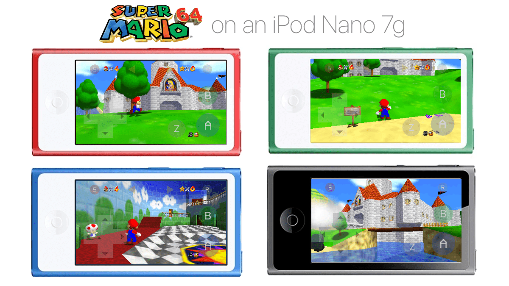
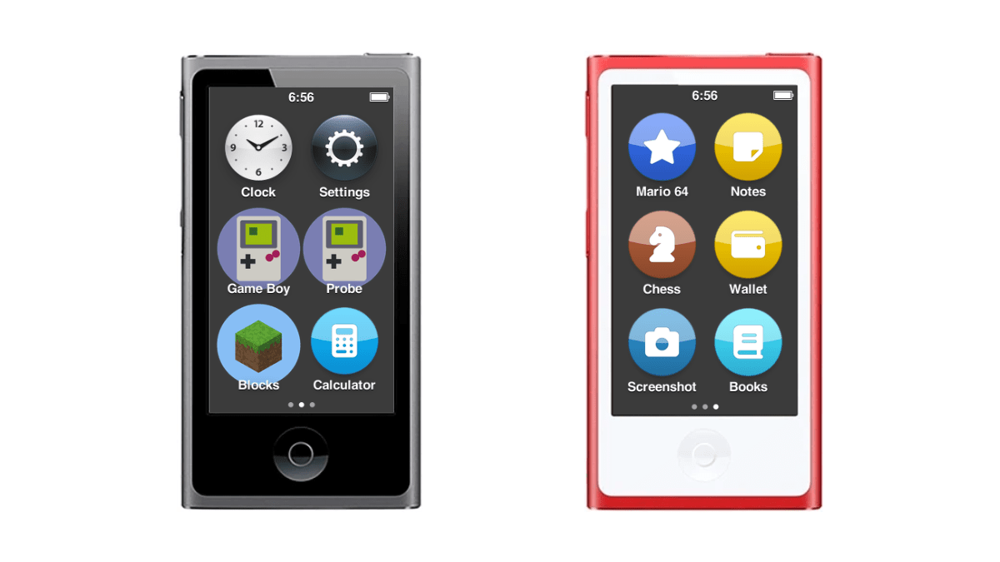
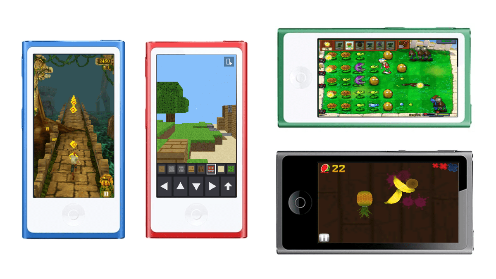
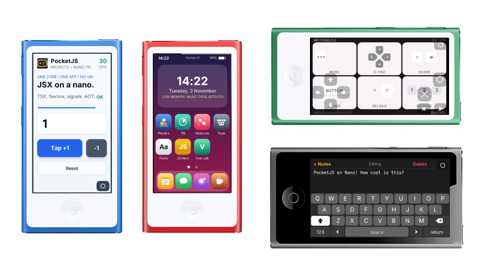

# nano7kit

Games and JavaScript apps for the iPod nano 7th generation, installed from a Mac.



nano7kit sits on top of [NanoApps 1.0](https://github.com/nfzerox/NanoApps) by nfzerox. It
keeps NanoApps' firmware and apps and adds:

- a fork of the NanoApps launcher that fits big games: it checks free memory before
  loading, reads large files in pieces and frees the app on Home, so you can switch
  between games without a restart
- Super Mario 64, Plants vs. Zombies, Temple Run and Fruit Ninja, built on your Mac from
  your own game files
- PocketJS: write nano apps in TSX, run them on QuickJS on the iPod
- a Terminal installer where you tick the apps you want

## Before you start

- **iPod:** nano 7G on firmware 1.1.2. I tested one Mid-2015 model (MKN52, 16 GB). The
  2012 model runs the same firmware but I haven't tried it.
- **Mac:** I tested an Intel Mac on macOS 13.5. On Intel, `./install` downloads its own
  Python, Arm compiler and other tools into `build/macos-intel` (no Homebrew, no
  password). Apple silicon should work with Homebrew ([docs/MACOS.md](docs/MACOS.md)) but
  I haven't tested it on hardware. You also need Xcode's command line tools
  (`xcode-select --install`). No Windows.
- **Cable:** Lightning. My Mac only saw the iPod in recovery mode through a USB-A hub.
- **Time:** tool setup takes a few minutes, once. Mario 64 takes several minutes
  to build.
- **Risk:** on the NanoApps base, nano7kit only copies files into `/Apps` and
  `/Library/resident.hbapp`, after backing up `/Library`, `/Apps` and `/NanoApps` to your
  Mac. Music is not touched. Writing firmware (step 1b below) is riskier: it takes a full
  disk image first and refuses if anything doesn't match. See [Undo](#undo).
- **Games:** not included. You supply your own copies (table below).

## Install

Already on NanoApps 1.0? Put the iPod in Disk Mode ([docs/BUTTONS.md](docs/BUTTONS.md)) and:

```sh
git clone https://github.com/shimku/nano7kit.git && cd nano7kit && ./install
```

Otherwise see [Full setup](#full-setup) at the bottom.



## Games



| Game | You supply | Port |
|---|---|---|
| Super Mario 64 | Super Mario 64 (USA) `.z64` | olievans123's, fetched and built on your Mac |
| PvZ Portable | the PC Plants vs. Zombies GOTY folder (`main.pak` and `properties/`) | PvZ-Portable engine plus a nano layer, `games/pvz_portable` |
| Temple Run | decrypted Temple Run 1.0 `.ipa` | olievans123's recompile, with my memory changes |
| Fruit Ninja | decrypted Fruit Ninja 1.0 `.ipa` | recompiled here, `games/fruitninja`. Swipes in a round are unreliable on 1.1 |

Put the files in `mygames/` (git ignores it) or drag them into Terminal when the
installer asks. Each file is hash-checked, so only those exact versions work. Nothing
built from them is committed. Hashes and the untested extras (Mario Kart 64, Flappy
Bird, Doodle Jump): [docs/GAMES.md](docs/GAMES.md).

## Writing apps

The nano gives an app a 240x432 touch screen, an accelerometer, OpenGL ES 1.1 and about
4 MB of memory. One app runs at a time.

In C, with the NanoApps SDK (NanoApps apps run unchanged on this launcher):

```sh
./start sdk new my_app --title "My App"
./start sdk build my_app
./start nabase add "My App"        # Disk Mode
```

Porting a big game: [docs/PORTING.md](docs/PORTING.md) walks through Mario 64, PvZ,
Temple Run and Fruit Ninja.

## PocketJS



[PocketJS](https://github.com/pocket-nexus/pocketjs) by pocket-nexus renders Solid or Vue
TSX components to native pixels. I added a nano 7G target, so an iPod app is a component
with flexbox and Tailwind-style classes, signals for state, touch (two fingers) and tilt.
It runs on QuickJS on the iPod, or is compiled ahead of time with MicroTS. An app is a
`.pocket` file in `/Apps/Data/PocketJS`, and `./start pocketjs emu` runs it on the Mac
first and reports its memory peak.

JS QuickJS, the PocketJS home screen, comes with Notes (with a keyboard, saves to the
iPod), Talk, yui540's Motion Lab, Cafe, Physics, Tilt, Gestures, Type and Fonts.

An example app, and how to build and add your own: [docs/POCKETJS.md](docs/POCKETJS.md).
PocketJS is fetched at `6ca9f914` and patched with `pocketjs/nano7g.patch`.

## Known issues

Fruit Ninja's menu works, but swipes during a round don't register reliably on 1.1 (they
did on 1.0); I'm working on it. No game has sound. More than 16 apps on Home, Mario Kart
64, Flappy Bird and Doodle Jump are untested.

## nano7kit, NanoApps and nano7-untethered

- **nano7-untethered** (olievans123): patched firmware flashed from a Linux PC. Needs a
  FAT32 disk, which erases the iPod. Comes with Blocks, Game Boy, Probe and the Mario
  ports. Finder can't update an iPod running it. nano7kit 1.0 was built on it.
- **NanoApps 1.0** (nfzerox): installs as a firmware update from Finder, iTunes or Apple
  Devices, on Mac or Windows, no Terminal. Over 40 apps and a C SDK. Its launcher keeps
  the last app loaded, so reopening it is quicker.
- **nano7kit 1.1**: NanoApps 1.0 plus PocketJS (JS/TSX apps), the Mario 64, PvZ, Temple
  Run and Fruit Ninja ports, a launcher fork that fits big games, and a Mac installer.
  Mac only, needs Terminal, tested on one Mid-2015 nano.

If you just want the apps, NanoApps alone is simpler. The nano7-untethered route is still
here as a fallback ([docs/FAT32.md](docs/FAT32.md)).

## Full setup

Clone the repo (`git clone https://github.com/shimku/nano7kit.git && cd nano7kit`), then:

**1. Put NanoApps 1.0's firmware on the iPod.** Music and files stay.

a. *Stock iPod:* `./start nabase ipsw` downloads `NanoApps-2015-Model.ipsw` and checks it
(`--model 2012` for the 2012 nano). In Finder, select the iPod, hold Option, click
**Check for Update** (not Restore) and pick that file. These are NanoApps'
[own steps](https://github.com/nfzerox/NanoApps#download-and-install-nanoapps).

b. *iPod on nano7-untethered (Finder says error 1461):* write the same firmware from
recovery mode. This is the route I tested. In Disk Mode, back up first:

```sh
./start backup     # full disk image; prints its path and SHA-256
./start --i-accept-untested-flasher --i-accept-2015-refresh nabase flash --dry-run \
  --backup IMAGE --backup-sha256 HASH --serial YOUR_SERIAL
```

Put the iPod in recovery mode when asked. If the dry run passes, run it again with
`--run` and type `FLASH`. It writes only `Firmware.MSE`. The serial is in Settings >
General > About. More: [docs/NANOAPPS-BASE.md](docs/NANOAPPS-BASE.md).

**2. Install.** In Disk Mode:

```sh
./install              # after 1a; pick 1 if it asks which way
./install --nanoapps   # after 1b
```

(Or double-click `Install nano7kit.command`.) Type the numbers you want, for example
`1 4 21`, then Enter on an empty line. Eject and restart the iPod.

**3. Add and remove later.** Run `./install` again: installed apps show `[on]`, type the
number to remove one. Or in Disk Mode:

```sh
./start nabase add 'Mario 64' --rom mygames/sm64.z64
./start nabase add 'PvZ Portable' --payload mygames/pvz-goty
./start nabase remove 'Paint'
```

Sync music in Disk Mode only: `./start sync`, then Finder or Music, never Restore
([docs/SYNC.md](docs/SYNC.md)).

## Undo

- NanoApps' own launcher back: `./start nabase restore` (Disk Mode). Your music and the
  NanoApps apps stay.
- Launcher off without a Mac command: create an empty file `/Library/disabled` on the iPod.
- Back to stock: Restore in Finder erases the iPod and installs Apple's firmware. I
  haven't tried that after `nabase flash`. If Finder can't, `./start rescue` writes stock
  1.1.2 from recovery mode ([docs/RECOVERY.md](docs/RECOVERY.md)).
- Firmware backup: the image from `./start backup` stays on your Mac.

## Troubleshooting

- **Finder: "error 1461" on Check for Update.** The iPod runs nano7-untethered. Use step 1b.
- **The iPod doesn't show up in Disk Mode.** Wait for "Do not disconnect" on screen
  ([docs/BUTTONS.md](docs/BUTTONS.md)), try another cable or port, then `./start find`.
  If you renamed the iPod, `./start nabase` commands take `--volume /Volumes/NAME`.
- **Recovery mode isn't detected.** Try a USB-A hub. My Mac needed one.
- **`REFUSED: did not type FLASH; nothing written` right after the prompt.** The prompt
  got an empty line, usually from pasting a command with a newline after it. Paste the
  command alone, wait for the prompt and type the word yourself.
- **`REFUSED:` line.** A check failed before anything was written. The message says which.
- **An app restarts the iPod.** In Disk Mode, `./start nabase remove 'App Name'`. To see
  where it died, restart normally to the Home screen, then Disk Mode and
  `./start apps lasttrace`.
- **PocketJS app misbehaves.** `./start pocketjs log` in Disk Mode prints its log.
- **Tools missing.** `./start doctor` lists what's missing.

To report a bug, open an [issue](https://github.com/Shimku/nano7kit/issues) with your
iPod model, Mac (Intel or Apple silicon, macOS version), the command you ran and its full
output. For crashes, add `./start apps lasttrace` or `./start pocketjs log`.

## Credits

Built on [NanoApps](https://github.com/nfzerox/NanoApps) by nfzerox (MIT), with fixes by
Merquice and Raphmatt; [nano7-untethered](https://github.com/olievans123/nano7-untethered)
and the Temple Run port by olievans123 (no licence stated, so fetched at build time, not
included); [PvZ-Portable](https://github.com/wszqkzqk/PvZ-Portable) by wszqkzqk
(LGPL-3.0); [PocketJS](https://github.com/pocket-nexus/pocketjs) by pocket-nexus (MIT,
pinned at `6ca9f914`) with Motion Lab by yui540; QuickJS; [Inter](https://rsms.me/inter/)
(OFL); wInd3x; ipod_sun. Everyone, with licences: [CREDITS.md](CREDITS.md). The old
untethered recovery, `./start apps restore-tested`, is in [docs/RECOVERY.md](docs/RECOVERY.md).

Unofficial and at your own risk. Not affiliated with Apple, Nintendo, Imangi, Halfbrick,
PopCap or any game developer. No game files, ROMs or Apple firmware are included. MIT,
see [LICENSE](LICENSE); some parts keep their own licence, see [NOTICE](NOTICE).
