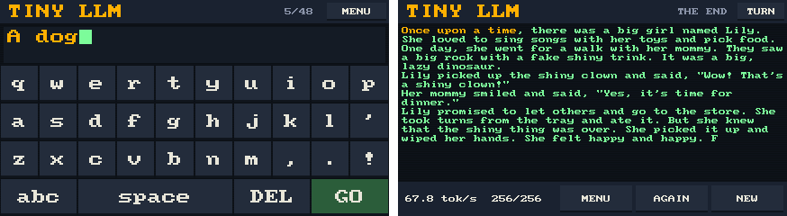
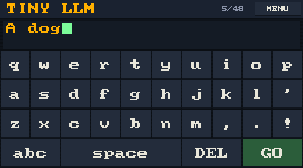
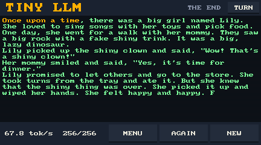
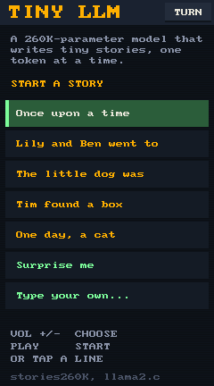
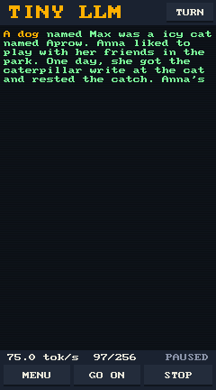

# Tiny LLM



A NanoApps app that runs a small language model on the nano and writes short
children's stories, one token at a time. I got the idea from a video of a
360K-parameter model running on a DOS PC at about 2 tok/s. This one uses
Andrej Karpathy's stories260K (260K parameters, trained on TinyStories) and an
inference engine based on his llama2.c, rewritten so it runs with integer maths
on the nano's Cortex-A5.

So far it has been run in the emulator, not yet on a real nano.

## Install

In Disk Mode, from the nano7kit folder:

```sh
source ~/nano7/env.sh
./start sdk build tinyllm          # builds the app and makes the model file
./start nabase add 'Tiny LLM'      # copies both to the iPod
```

`./start nabase add 'Tiny LLM'` on its own also does the build if needed. On the
nano7-untethered layout use `./start apps add 'Tiny LLM'`.

The weights are not in this repository. The build downloads `stories260K.bin`
and `tok512.bin` from [karpathy/tinyllamas](https://huggingface.co/karpathy/tinyllamas)
at commit `0bd21da7`, checks their SHA-256 sums, and converts them on your
computer into one 289 KB file that goes to `/Apps/Data/TinyLLM/model.bin`.
Both files are cached in `build/tinyllm/`.

## Using it








- Tap a story start, "Surprise me" (an empty prompt) or "Type your own..."
  for a keyboard. Up to 48 characters, and it starts with a capital letter for you.
- Or use the buttons: Vol +/- moves the highlight, Play/Pause starts it.
- While it writes, the bar at the bottom shows tok/s and the position (out of 256).
  MENU goes back, PAUSE pauses, STOP ends the story. When it is done, AGAIN
  writes another one from the same start and NEW goes back to the menu.
- Play/Pause pauses and resumes, Vol +/- scrolls a long story.

### Sideways

The keyboard is always sideways: hold the iPod on its side with Home on the
right, the same way round as PvZ Portable and the PocketJS landscape apps. The
keys use the whole 432 px width, 43x42 px each (upright they would be 24 px
wide), with letters at double size, and caps, space, DEL and GO along the
bottom row. MENU is at the top right.

Opening the keyboard turns the whole app sideways, so the story you start from
it is sideways too, at 53 characters by 17 lines. TURN at the top right of the
menu and story screens switches between upright and sideways at any time. Each
launch starts upright. The error screens are always upright.

Held that way the volume buttons are on the bottom edge, Vol + on the left:

| Sideways | Vol + | Vol - | Play/Pause |
|---|---|---|---|
| Keyboard | space | delete | GO |
| Menu | highlight up | highlight down | start |
| Story | scroll back | scroll forward | pause, or again when done |

The text is shown at up to 60 characters a second so it reads like typing. The
model runs ahead of that and stops when it is 48 characters ahead, so the screen
stays smooth. Each frame does at most 20 ms of model work.

## Model and licence

| | |
|---|---|
| Model | stories260K: dim 64, 5 layers, 8 heads (4 KV heads), hidden 172, vocab 512, trained on 512 tokens |
| Weights | MIT, karpathy/tinyllamas |
| Engine | `nanoapps/apps/tinyllm/tllm.c`, follows llama2.c (MIT, [LICENSES/llama2.c-MIT.txt](../LICENSES/llama2.c-MIT.txt)) |
| Context | 256 tokens, one story per run |
| Sampling | temperature 0.9, top-p 0.9, a new seed each time |

The app's own code is MIT, like the rest of nano7kit.

## How it runs on the nano

The nano 7G has no FPU that NanoApps apps can count on, so NanoApps code is built
soft-float (`-mfloat-abi=soft`, with `-mcpu=cortex-a5 -mfpu=vfpv4-d16` for the
instruction set). Float maths in llama2.c's forward pass would all go through libgcc,
so the engine does almost everything in integers:

- `mkmodel.py` stores every weight matrix as int8 with one float scale per row.
  The model file is 289 KB instead of about 1 MB for float32.
- Activations are rounded to int8 before each matrix multiply, so the inner loop
  is an 8-bit dot product (SMLAD on ARM, four multiplies per two instructions).
- The KV cache is int16. Attention scores use a 256-entry exp2 table and the
  softmax is done in fixed point. SiLU uses a sigmoid lookup table.
- The sampler (temperature and top-p) is integer too. Only RMSNorm, RoPE and the
  per-row scales use soft float.

With greedy sampling the int8 model writes the same opening as the float32 model
in llama2.c ("Once upon a time, there was a little girl named Lily. She loved to
play outside in the park. One day, she saw a big, red ball."). Later sentences drift
slightly, as expected from int8 rounding.

## Memory

| | Size |
|---|---|
| `Tiny LLM.hbapp` | 88 KB file, 99 KB once loaded |
| Model file | 289 KB |
| One working block (model, KV cache, buffers) | 464 KB |
| Stack | under 1 KB |
| Total | about 560 KB |

The app makes one allocation, the 464 KB block, and keeps it as its aux block so the
launcher frees it when you leave. Before allocating it checks the largest free block,
and it wants 512 KB still free afterwards for music and the launcher. If that fails
it shows a "not enough memory" screen with the numbers instead of trying.

It was tested at both memory levels seen on this nano: about 3.9 MB free with a
2 MB largest block (music playing) and about 6 MB free with a 4 MB largest block.
It runs the same at both. The memory screen appears when less than about 1 MB is
free or the largest block is under about 520 KB.

The model file is checked before use: header, shape, size and a CRC32 of the whole
payload. A missing file, a short file or a file with a changed byte each get their
own screen telling you to copy it again. The app never writes to the disk.

## Speed

The emulator counts the exact number of instructions per token: about 1.9 million
at the start of a story, 2.4 million at position 64 and 2.9 million at the end,
2.6 million on average over a full 256-token story (attention grows with the context).

The nano's Cortex-A5 runs at about 320 MHz. At 0.55 instructions per cycle that is
about 70 tok/s, and the readout in the emulator, timed at 175 million instructions a
second, shows 68 to 79 tok/s. The real figure depends on cache misses: each token
reads the whole 289 KB model, which does not fit in the A5's caches. My guess is
40 to 100 tok/s, so a full story takes 3 to 6 seconds. The tok/s readout on the
device is timed with the real clock, so it will show the true number.

## Testing

`tests/test_tinyllm.py` checks it under conditions close to the iPod:

- The `.hbapp` is built the same way as for the device (`mkrelocapp` HRL1 layout,
  `-mword-relocations`, Cortex-A5, soft float, vfpv4-d16) and is checked for
  no host libc unwinder symbols.
- The emulator (`nanoapps/apps/tinyllm/emu.py`, on Unicorn and the PocketJS harness)
  loads that `.hbapp`, places it in a heap with 3.9 MB free and a 2 MB largest block,
  or 6 MB free with a 4 MB largest block, and drives it with taps and button presses.
- It checks the menu, the keyboard, a story with a typed prompt, pause, relaunch
  without leaking memory, the stack depth, low memory, a missing model, a truncated
  model and a model with one changed byte.
- Sideways: the keyboard is driven with taps in the turned view, mapped to the
  panel the same way the touch screen reports them, and each shot records which way
  up it was. It checks TURN on the menu and story, the keyboard's MENU key, and the
  volume buttons on the keyboard (Vol - deletes, Vol + adds a space).
- The tokens written in the emulator match the engine built for the host with the
  same seed, and `TINYLLM_FULL=1` runs a full 256-token story.
- `./start nabase add 'Tiny LLM'` is checked against a test disk.

```sh
python3 -m unittest tests.test_tinyllm -v
TINYLLM_FULL=1 TINYLLM_SHOTS=/tmp/shots python3 -m unittest tests.test_tinyllm
```

Screenshots of every screen are in `nanoapps/apps/tinyllm/screenshots/`.

## Files

| File | |
|---|---|
| `nanoapps/apps/tinyllm/tinyllm.c` | the app: screens, keyboard, buttons |
| `nanoapps/apps/tinyllm/tllm.c`, `tllm.h` | the engine |
| `nanoapps/apps/tinyllm/mkmodel.py` | llama2.c checkpoint to model file (Python, no extra packages) |
| `nanoapps/apps/tinyllm/tllm_host.c` | the engine on your computer: `make -C nanoapps/apps/tinyllm host` |
| `nanoapps/apps/tinyllm/emu.py` | the emulator script used by the tests |
| `host/tinyllm.py` | download, hash check and conversion |
