# Tiny LLM

A 260K-parameter story model (stories260K from karpathy/tinyllamas) running on the
iPod nano 7G with an int8 version of llama2.c. Details, memory use, speed and tests:
[docs/TINYLLM.md](../../../docs/TINYLLM.md).

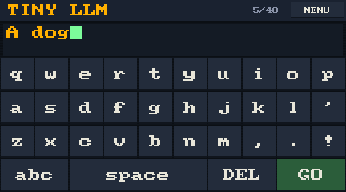

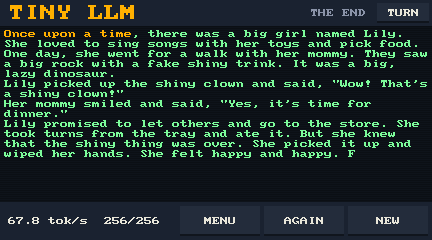
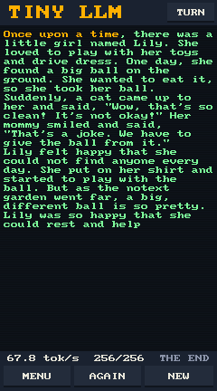

## Install

```sh
source ~/nano7/env.sh
./start sdk build tinyllm
./start nabase add 'Tiny LLM'      # Disk Mode
```

The weights are fetched at build time (pinned commit, SHA-256 checked) and converted
into `/Apps/Data/TinyLLM/model.bin`. They are not in git.

## Controls

| | |
|---|---|
| Tap a line, or Vol +/- and Play/Pause | pick a story start |
| Type your own... | sideways keyboard (Home on the right), GO or Play/Pause to start; Vol + space, Vol - delete |
| TURN (top right) | switch the menu or story between upright and sideways |
| MENU / PAUSE / STOP | under the story; AGAIN and NEW when it ends |
| Play/Pause | pause and resume |
| Vol +/- | scroll the story |

## Screens

| | | |
|---|---|---|
| 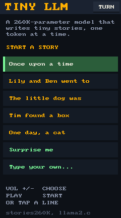 | 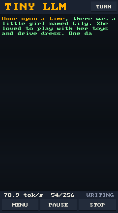 | 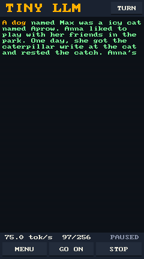 |
| 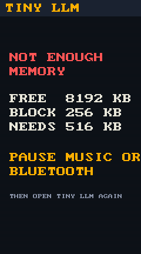 | 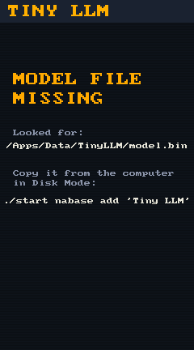 | 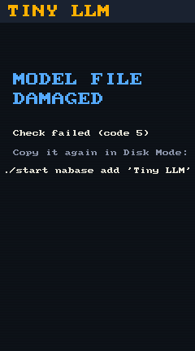 |

Sideways:

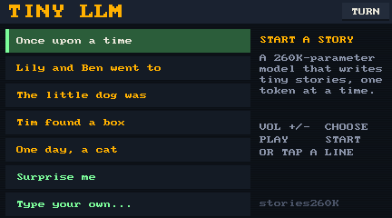
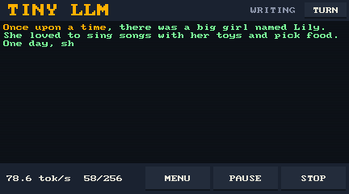

## On your computer

```sh
make -C nanoapps/apps/tinyllm host
nanoapps/apps/tinyllm/build/tllm_host untether/artifacts/extra/Data/TinyLLM/model.bin -i "Tim found a box"
```

Licences: the app is MIT; the engine follows llama2.c (MIT) and the weights are MIT.
See [NOTICE](NOTICE).
